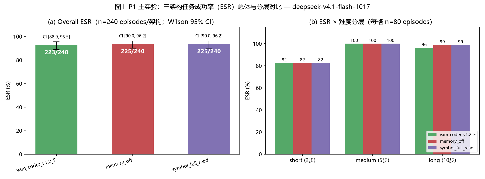
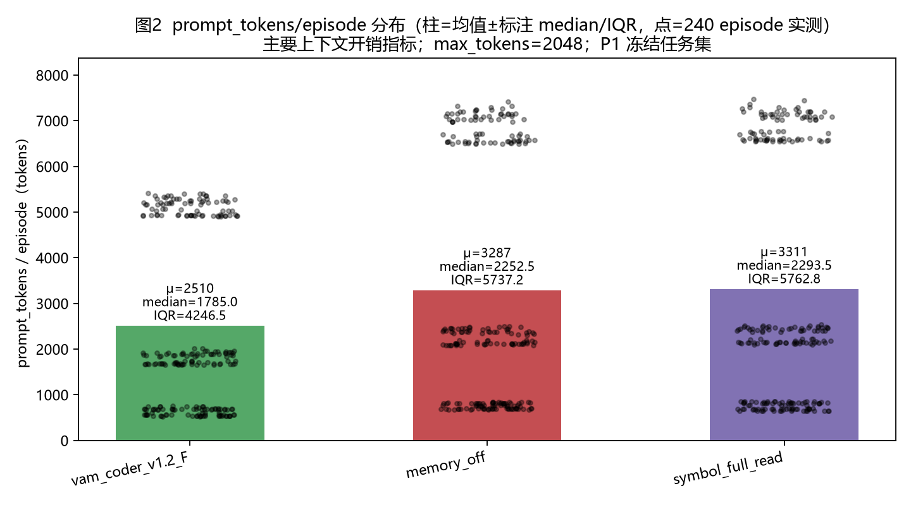
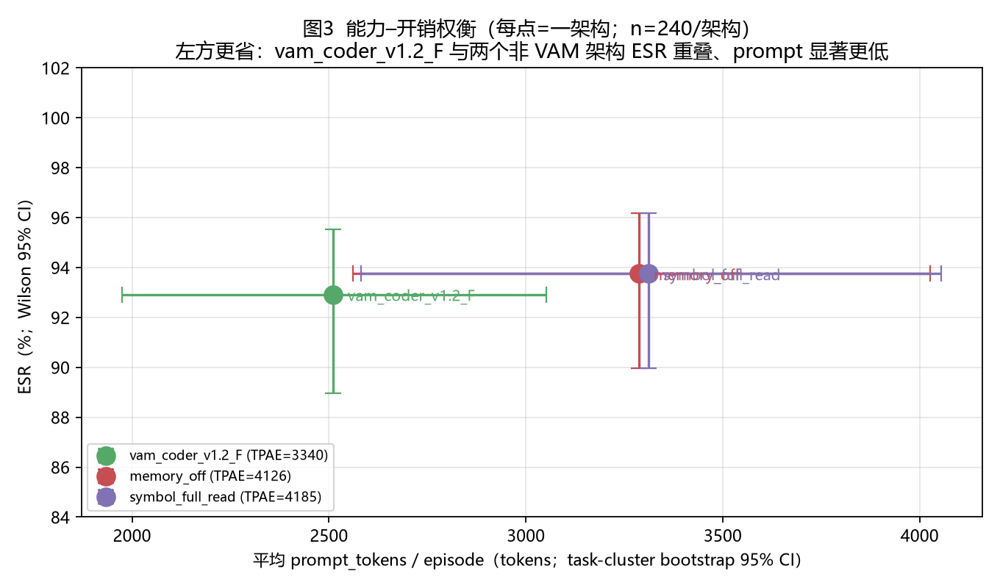
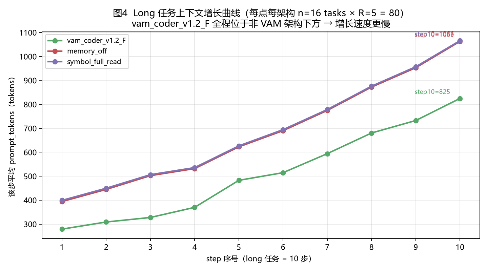
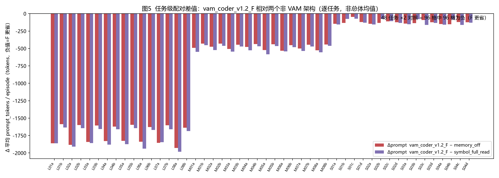
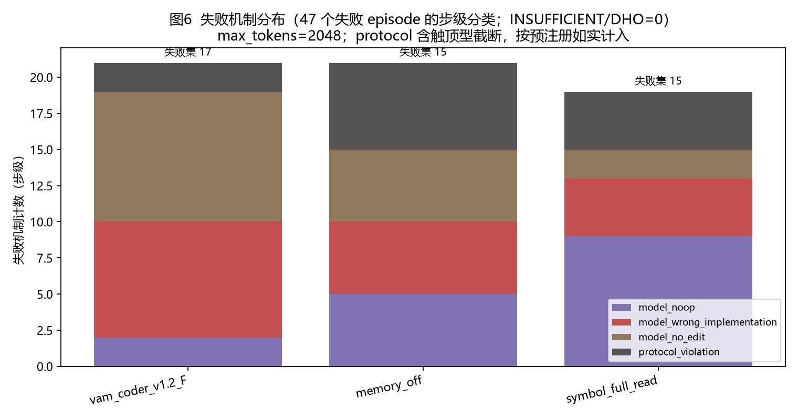
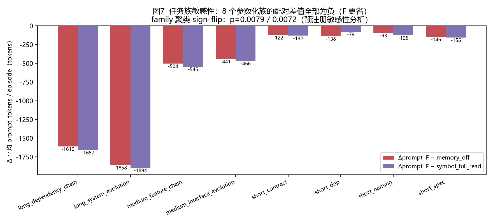

# P1 确认性实验报告：`vam_coder_v1.2_F` 效率与能力保持验证

状态：**完成**（预注册 v1 确认性批次）。架构一律完整英文标识。  
预注册：`p1/docs/v12f_validation_preregistration.md`（sha256 `088898a3…7ed`，冻结于任何 P1 模型请求之前）。

---

## 1. 实验环境与冻结核验

| 项 | 值 |
| --- | --- |
| 模型 | `deepseek-v4.1-flash-1017` @ `https://maas.qianwenaiapi.com/compatible-mode/v1`（key 仅经环境变量注入，未写入任何产物） |
| 解码 | temperature=0, seed=0, max_tokens=**2048**（P0 实验6 判定：1024 触顶 FAIL、4096 出现 runaway FAIL） |
| 历史 | keep（24000 字符预算） |
| 冻结核验（开跑前逐项通过） | prereg sha `088898a3…`、p1_tasks sha `d44445b2…`、SYSTEM_PROMPT `4f591635…`、build_messages `f0b477b0…`、p1_common `b6ce07a3…`（含可选鉴权头的传输层变更） |
| 统计 seed | 随机化 20261107（仅 episode 顺序，写入 `randomization_manifest.json`）；bootstrap **20261102**，B=10000，cluster=task_id |

## 2. 任务集概况（`p1/tasks_p1_validation/`，创建后先冻结）

- **48 题**：Short 16（2 步）/ Medium 16（5 步）/ Long 16（10 步）= **272 步**；8 个参数化任务族（各族变体共享结构、不同领域词汇与数值；预注册 §5 已披露并约定族级敏感性分析）。
- 冻结前验证全绿：272 步 eval「初态必败 / 参考态必过 / stepk 在 refk−1 必败」、目标解析对齐、与 v1+holdout1 文件 hash 交集=0、指令零逐字复用、集内指令唯一。
- **144 个必要信息点**预声明（implementation 48 / critical_data 40 / history 32 / interface 24；隐藏项 36 个）——CIRE/CMR 分母就绪（P2 使用）。
- 物化脚本 `materialize_p1_tasks.py` 对照冻结 manifest 逐哈希复核通过。

## 3. 实际运行规模与停机

| 项 | 计划 | 实际 |
| --- | --- | --- |
| Episodes | 720（48×3×R5） | **720/720 全 OK**（断点续跑一次：冒烟 3 集并入） |
| 请求 | ≤4080 | **4080/4080**（每步 1 次，无跳过、无重试） |
| Tokens（P+C） | S5=6,600,000（2× 预估 3.3M） | **2,796,334（42.4%）→ 未触发** |
| 架构顺序 | seed=20261107 随机化 | `randomization_manifest.json` 固化 |
| 停机表 | S1–S5 | **全部未触发**（INSUFFICIENT=0、无 server 拒绝、无超预算） |

## 4. 主结果（`metrics_summary.csv` scope=architecture，n=240/架构）

| 指标 | `vam_coder_v1.2_F` | `memory_off` | `symbol_full_read` |
| --- | ---: | ---: | ---: |
| **ESR**（Wilson 95% CI） | 0.9292 [0.890, 0.955] | 0.9375 [0.900, 0.962] | 0.9375 [0.900, 0.962] |
| 成功/总数 | 223/240 | 225/240 | 225/240 |
| SPR | 0.9846 | 0.9846 | 0.9860 |
| **prompt mean（sd）** | **2,510（1,911）** | 3,287（2,606） | 3,311（2,621） |
| prompt median [IQR] | 1,785 [4,247] | 2,253 [5,737] | 2,294 [5,763] |
| prompt 合计 | **602,451** | 788,935 | 794,730 |
| completion 合计 | 199,109 | 201,412 | 209,697 |
| **TPAE** | **3,339.8** | 4,126.4 | 4,185.1 |
| TPSE | **3,594.4** | 4,401.5 | 4,464.1 |
| FETC_mean | 2,810.7 | 2,711.1 | 2,676.8 |
| 请求/集 · 耗时/集 | 5.67 · 33.4s | 5.67 · 35.0s | 5.67 · 34.6s |
| INSUFFICIENT · DHO | **0 · 0** | 0（NA 口径） | 0（NA 口径） |

**难度分层（prompt mean / ESR）**：

| 难度 | `vam_coder_v1.2_F` | `memory_off` | `symbol_full_read` |
| --- | --- | --- | --- |
| short | 624 / 82.5% | 749 / 82.5% | 747 / 82.5% |
| medium | 1,792 / **100%** | 2,265 / 100% | 2,298 / 100% |
| long | **5,115 / 96.3%** | 6,849 / 98.8% | 6,890 / 98.8% |

（short 三架构 ESR 完全相同 → 见 §8 任务级失败集中；long 上 F 比对照省 **1,734 tok/集（−25%**））

## 5. 统计分析（预注册 §4）

### 5.1 RQ1 效率 —— 成立

主比较（task-cluster bootstrap，seed=20261102，B=10000；sign-flip 双侧 α=0.05，Holm 校正两主比较）：

| 配对（Δ = F − 对照） | Δprompt/集 [95% CI] | ΔTPAE [95% CI] | sign-flip p（Holm） |
| --- | --- | --- | --- |
| `vam_coder_v1.2_F` − `memory_off` | **−777.0 [−974.8, −584.4]** | −786.6 [−979.3, −601.8] | **0.0002** |
| `vam_coder_v1.2_F` − `symbol_full_read` | **−801.2 [−1003.3, −603.3]** | −845.3 [−1058.7, −640.1] | **0.0002** |

- 相对降幅：**prompt/集 −23.6% / −24.2%**；TPAE 同步下降约 19–20%（含 completion 侧）。
- **族级敏感性（8 族）**：两个主对照的族均值差 **8/8 全负**，family sign-flip p=0.0079 / 0.0072——把同族变体当相关单元，结论不翻转。
- 效应量与 CI 为主、p 值为辅（预注册要求）；次要比较 `memory_off−symbol_full_read` 的 prompt 差仅 −24 tok（两者同为"重上下文"基线，预期接近）。

### 5.2 RQ2 能力保持 —— 非劣判定 PASS

| 配对 | ΔESR [95% CI] | 非劣边界 −12pp | 判定 | McNemar（敏感性） |
| --- | --- | --- | --- | --- |
| F − `memory_off` | −0.0083 [−0.0417, +0.0292] | 下界 −4.2pp ≫ −12pp | **PASS** | p=0.80（7 vs 9 翻转） |
| F − `symbol_full_read` | −0.0083 [−0.0542, +0.0292] | 下界 −5.4pp ≫ −12pp | **PASS** | p=0.77（5 vs 7） |

sign-flip ESR 均不显著（Holm=1.0）。**预注册表述**：在 ±12pp 非劣边界下，`vam_coder_v1.2_F` 的能力保持成立；**不作 ESR 优效主张**（与 P0 功率分析结论一致：8pp 级差异在可行样本量下不可检）。

### 5.3 功率对照（P0 `power_analysis.csv`）

- token 主效应：预期功效 ≥0.99（N=40×R=5）→ **实测 CI 全负、Holm p=0.0002，兑现**；
- ESR：预注册已声明不做优效 → 实测差 −0.83pp、CI 跨 0，**按声明口径报告为非劣通过 + 无优效证据**。

## 6. 图表（figures/，数据源自 raw_results/bootstrap/failure_analysis）

**图4 是核心机制图**：Long 任务十步全程，`vam_coder_v1.2_F` 的每步 prompt 从 281→825，两个非 VAM 架构 397→1069——**省略的是"全仓倾倒"的固定成本，且随步数线性累积**；图7 表明该优势在 8 个族全部同号。

## 7. 失败案例（47 集；`failure_analysis.csv`）

| 架构 | 失败集 | noop | wrong_impl | NO_EDIT | protocol |
| --- | ---: | ---: | ---: | ---: | ---: |
| `vam_coder_v1.2_F` | 17 | 2 | 8 | 9 | 2 |
| `memory_off` | 15 | 5 | 5 | 5 | 6 |
| `symbol_full_read` | 15 | 9 | 4 | 2 | 4 |

- **任务级集中**：`p1_S03c`（弱命名歧义族）**15/15 全灭**——三架构一致失败，属任务-模型交互的系统性失败；按预注册**计入 ESR、不剔除**（排除规则未预授权任何事后剔除）。`p1_S04c/b、S01c、S02c` 共22 集；Medium 段 0 失败；Long 段仅 5 集。
- protocol 残留：max_tokens=2048 下仍有 2/6/4 步（触顶型截断与格式违规混合）——量级远低于 1024 档的复现值，已按 §4.5 如实计失败并单列。
- 安全类：INSUFFICIENT=0、DHO=0、architecture 违规=0（`vam_coder_v1.2_F` 注入审计 240 集全量）。

## 8. 机制解读（RQ3，部分回答；完整归因待 P2 消融）

1. **收益来源**：`vam_coder_v1.2_F` 的选择性注入省掉的是非相关文件的全量倾倒——短任务省固定小成本（−125/集），长任务省线性累积成本（−1,734/集）；图4/图5/图7 三条证据一致。
2. **能力侧无结构性代价**：ESR/SPR 分层后差异仍≤2.5pp（long），CI 内；F 的失败构成偏 NO_EDIT（生成侧），而非上下文缺失（无一例失败归因于关键文件未注入——DHO=0、INSUFFICIENT=0）。
3. **待 P2 回答**：省益中有多少来自 must 闭包 vs 非相关 NONE vs O′ 复用（预注册 §6 消融矩阵）；关键信息点的 CMR/IRR 用 144 个预声明分母计算。

## 9. 局限

1. **任务族参数化**：48 题来自 8 族，有效独立设计数 <48；族级敏感性已做（结论稳），但跨域泛化需外部任务集（P3 方向）。
2. **单模型**：结论限于 `deepseek-v4.1-flash-1017`；跨族模型泛化属 P3。
3. `p1_S03c` 的任务级全灭拉低 short 段 ESR（三架构同拉），按预注册保留——报告与附录须同时给出该任务明细。
4. protocol 残留（12 步）未清零；已按预注册计入，后续可做 max_tokens/格式提示敏感性。
5. 探索轮（round1–3，1.5B 与早期云轮）**不与本确认性数据合并**（预注册 §11.3）。

## 10. 结论与下一步

- **RQ1：成立**——上下文开销 −24%（CI 全负、Holm 显著、族级 8/8 同号、随难度放大）。
- **RQ2：非劣 PASS**——ESR 差 −0.83pp，CI 下界 ≥ −5.4pp，远优于 −12pp 边界；不作优效主张。
- **RQ3：部分回答**——机制与增长曲线证据链成立，完整归因待 **P2 消融**（§6 矩阵：digest/none/去闭包/去 O′/redact 历史/交互）与 CIRE（144 信息点的 CMR/IRR）。

下一步：P2 消融批次（预注册 §6）→ P3 跨模型与集内记忆污染边界。

## 11. 交付物与追溯

同目录：`raw_results.csv`（4080 步）、`metrics_summary.csv`（3 架构 + 9 难度层 + 144 任务层）、`bootstrap_results.csv`、`signflip_tests.csv`、`family_sensitivity.csv`、`failure_analysis.csv`（47 集）、`analysis_manifest.json`（含非劣判定记录）、`figures/fig1–fig7`、`run_meta.json`、`randomization_manifest.json`、`execution_log.jsonl`、`execution_summary.json`。  
任务集：`p1/tasks_p1_validation/`（`p1_tasks.json` + `p1_tasks_manifest.json` + 48 任务磁盘树）。  
追溯：`episode_id = task_id_{architecture}_R{rep}` → `episode_logs/<id>/runner_out/episodes/<task>/<baseline>/steps/<step>/`。
