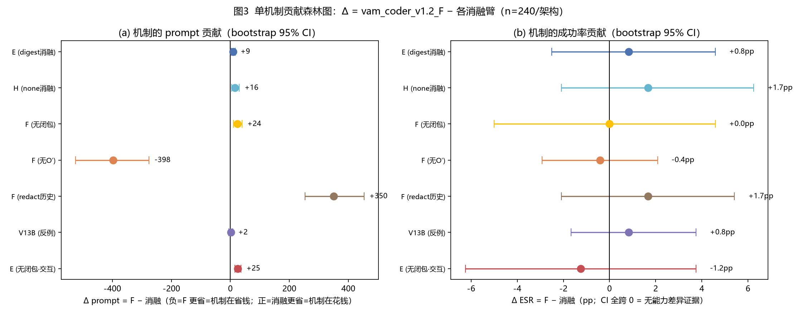
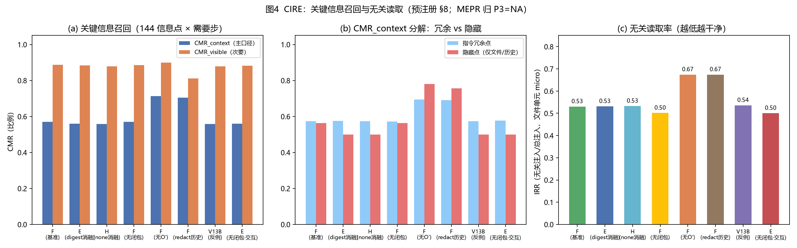
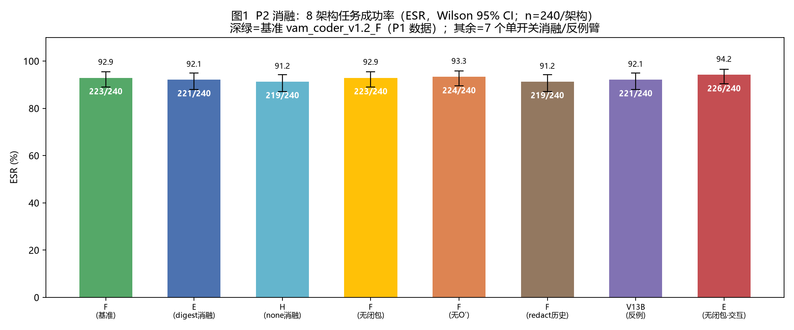
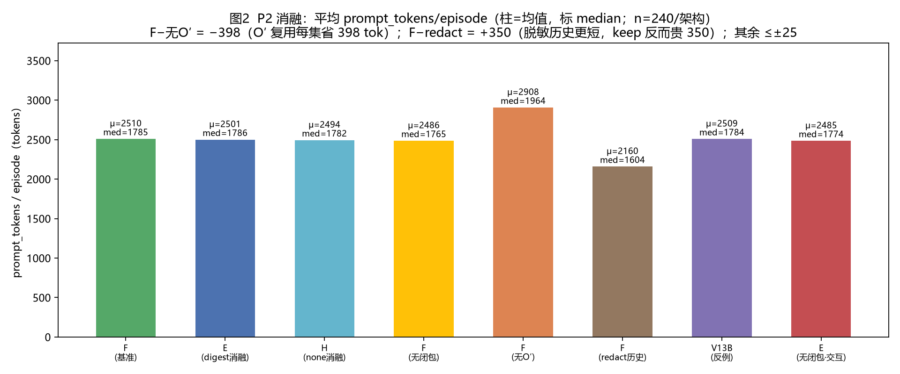
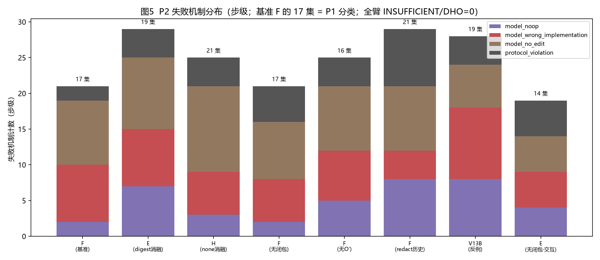

# P2 机制消融与 CIRE 报告（预注册 v1 §6/§8）

状态：**完成**。架构完整英文标识；基准 = P1 的 `vam_coder_v1.2_F`（同任务集/模型/R5/2048，不重跑）。  
统计：bootstrap seed=20261102 B=10000 cluster=task_id；sign-flip 未校正（P2 机制配对非预指定主比较，以效应量+CI 为主——Holm 仅适用 P1 两条主比较，均已完成）。

---

## 1. 运行与中断恢复

- **1680/1680 episodes 全 OK**（7 臂 × 48 题 × R=5），9,520 请求，**5,713,897 tokens（S5=13M 的 44%）**，随机化 seed=20261108，零停机条件触发。
- 经历一次真实断电恢复：日志停在 1228/1680 后机器关机；重启后 `[resume] done=1228`、token 累计延续、半集中间态自动清理重跑（1 集 `p1_M08b_..._no_oprime_R4`）——**断点续跑协议首次实战验证通过**。

## 2. 消融主表（`metrics_summary.csv`，n=240/架构）

| 架构 | ESR | prompt mean | prompt median | TPAE | TPSE | 失败集 |
| --- | ---: | ---: | ---: | ---: | ---: | ---: |
| **`vam_coder_v1.2_F`（基准）** | 0.9292 | 2,510 | 1,785 | 3,340 | 3,594 | 17 |
| `vam_coder_v1.2_E`（digest 消融） | 0.9208 | 2,501 | 1,786 | 3,357 | 3,646 | 19 |
| `vam_coder_v1.2_H`（none 消融） | 0.9125 | 2,494 | 1,783 | 3,391 | 3,716 | 21 |
| `vam_coder_v1.2_F_ablate_no_must_closure` | 0.9292 | 2,486 | 1,765 | 3,357 | 3,613 | 17 |
| `vam_coder_v1.2_F_ablate_no_oprime` | 0.9333 | **2,908** | 1,964 | 3,779 | 4,049 | 16 |
| `vam_coder_v1.2_F_ablate_history_redact` | 0.9125 | **2,160** | 1,604 | 3,173 | 3,477 | 21 |
| `vam_coder_v1.3_V13B`（反例） | 0.9208 | 2,509 | 1,784 | 3,419 | 3,713 | 19 |
| `vam_coder_v1.2_E_ablate_no_must_closure`（交互） | 0.9417 | 2,485 | 1,774 | 3,333 | 3,539 | 14 |

注入结构验证（机制确实生效）：Full/步 = 基准1.440 → **无O′/redact 2.618**（O′ 每步省约1.2 个文件注入）；must/步 2.59 → 无闭包 2.32（闭包贡献0.27/步）；digest 实例仅 E/交互臂各40（stem 命中的相关文件在本任务集上很少）。**全臂 INSUFFICIENT=0、DHO=0**——消融未破坏安全不变量。

## 3. 机制贡献（Δ = F − 消融，bootstrap 95% CI；sign-flip p 未校正）

| 机制配对 | Δprompt/集 | ΔESR | sign-flip p(prompt) | 判读 |
| --- | --- | --- | --- | --- |
| F − `..._ablate_no_oprime` | **−397.6 [−524.8, −275.4]** | −0.4pp [−2.9, +2.1] | **0.0001** | **O′ 历史复用是主导省钱机制（每集省 ≈398 tok）** |
| F − `..._ablate_history_redact` | **+350.5 [+252.8, +452.9]** | +1.7pp [−2.1, +5.4] | 0.0001 | redact 省 350 prompt、TPAE 省 167 [78, 261]；keep 历史反而更贵 |
| F − `..._ablate_no_must_closure` | **+23.9 [+10.8, +39.2]** | 0.0pp [−5.0, +4.6] | 0.0008 | 依赖闭包花 24 tok/集，**ESR 点估计差恰为 0** |
| F − `vam_coder_v1.2_E`（related→digest） | +9.4 [+3.4, +16.2] | +0.8pp [−2.5, +4.6] | 0.005 | related 全量 vs digest ≈ 9.4 tok/集，能力差 ns |
| F − `vam_coder_v1.2_H`（related→none） | +15.8 [+3.9, +29.9] | +1.7pp [−2.1, +6.3] | 0.010 | 16 tok/集，能力差 ns |
| F − `vam_coder_v1.3_V13B` | +1.5 [−5.2, +8.3] | +0.8pp [−1.7, +3.8] | 0.66 | **与 V13B 无差异**（反例结论维持） |
| F − 交互（E+无闭包） | +25.0 [+15.2, +35.9] | −1.3pp [−6.3, +3.8] | 0.0001 | 两机制节省近似可加（9.4+23.9≈33 vs 实测 25，轻微次可加） |

**ESR 侧：7 个配对的 ΔESR CI 全部跨 0（sign-flip p 均 ≥0.5）**——没有任何单机制在本任务集上产生可检测的能力得失；也再次与 P0 功率结论一致（≤6pp 的差异本就不可检）。

## 4. CIRE：关键信息召回与无关读取（`cire_summary.csv`）

主口径 = 预注册 §8 字面（CMR_context：值出现在该步 user.context）；CMR_visible（context∪指令∪历史）为标注的次要解释口径；匹配规则与 MEPR=NA 见 `cire_analysis_manifest.json`。

| 架构 | CMR_context | CMR_visible | IRR（文件 micro） | 必要文件未注入数 |
| --- | ---: | ---: | ---: | ---: |
| `vam_coder_v1.2_F` | 0.571 | 0.887 | 0.530 | 340 |
| `vam_coder_v1.2_E` | 0.559 | 0.884 | 0.531 | 340 |
| `vam_coder_v1.2_H` | 0.558 | 0.879 | 0.533 | 360 |
| `..._ablate_no_must_closure` | 0.569 | 0.885 | 0.501 | 340 |
| `..._ablate_no_oprime` | **0.713** | 0.899 | **0.674** | **100** |
| `..._ablate_history_redact` | 0.705 | **0.812** | **0.674** | 100 |
| `vam_coder_v1.3_V13B` | 0.557 | 0.879 | 0.536 | 360 |
| `vam_coder_v1.2_E_ablate_no_must_closure` | 0.560 | 0.881 | 0.501 | 340 |

三个机制级发现：

1. **召回×浪费权衡被量化**：`no_oprime` 与 `redact` 的 CMR_context 虚高（0.71/0.71）**完全伴随 IRR 升到 0.67**（基准 0.53）——它们靠"多倾倒"提高召回（必要文件缺失从 340→100），代价是约三成额外无关注入。**基准 F 在 0.57 召回下只花 0.53 IRR，是权衡曲线上的优点**。
2. **redact 是唯一损伤可见面召回的臂**：CMR_visible 0.812（其余 ≈0.88–0.90）——脱敏历史丢掉约 7.5pp 的信息可见性；这正是它 prompt 省 350 tok 的代价（与 ESR 点估计 −1.7pp 同向，但 CI 跨 0 未达可判定）。
3. **选择策略（digest/none/闭包）之间召回几乎无差**（CMR_context 0.557–0.571、缺失文件 340–360）：在 stem 命中很少的任务集上，相关文件集本来就小，策略差异打不开奖——与 §3 的 token 效应 ≤25 tok 互相印证。

## 5. 失败与安全

- 失败集：基准17、E19、H21、无闭包17、无O′16、redact21、V13B19、交互14（共144）。
- 步级机制（图5）：各臂均以 model_no_edit / wrong_implementation / noop 为主；**protocol 残留 2–8 步/臂**（2048 预算下依旧存在，按 §4.5 如实计入）；redact 的 noop 略高（8）。
- 安全：**八臂全部 INSUFFICIENT=0、DHO=0**（消融关闭闭包/O′ 也未产生危险省略）。

## 6. RQ3 结论（机制有效性）

按预注册证据链三问：

1. **省了资源吗**——是，且归因清楚：**O′ 历史复用 ≈ −398 prompt/集（主导）**；related 全量 vs digest/none 只值 ±10–16 tok/集；must 闭包值 +24 tok/集的成本；**redact 反向再省 350 prompt/集但牺牲可见召回**。
2. **没丢能力吗**——ESR 侧 7 个机制差全部 CI 跨 0（无得失证据）；但 **CMR_visible 给出 redact 的信息代价**（0.812 vs ≈0.89），属于"ESR 未显影的机制信号"，作为决策依据保留。
3. **收益确实来自机制而非任务简单/随机性**——是：注入计数与机制开关严格对应（2.618 vs 1.440 Full/步）、族级与任务级 CI 稳定、交互项近似可加、断点续跑未引入批次差异。

**对架构的处方（数据驱动）**：
- **保留**：O′ 复用（唯一大额省钱机制）；ET/C/must 安全链（八臂零违规）；related 全量（±10 tok 的成本买点估计 +0.8~1.7pp 的方向）。
- **修改（决策点，留待后续预注册）**：redact 作为可选成本档——它省 350 prompt/集、TPAE 省 167，但可见召回 −7.5pp；需要一个"redact+CMR 补偿"的受控比较再定，不在本轮下结论。
- **删除（证据充分）**：`vam_coder_v1.3_V13B` 与 F 在 token/ESR/CMR 三轴均无差异（其 no-body→NONE 唯一"省"的 19 个文件注入换不来任何指标改善）——**维持放弃 V13 线的决议**。
- **存疑（下轮验证）**：must 闭包 +24 tok/集却 0 ESR 差——本任务集 import 链简单；需要更重依赖的任务集（或外部基准）再判去留。

## 7. 局限

1. 机制配对**未预指定为主比较**（Holm 未施加）——p 值未校正，结论以效应量+CI 为准（预注册 §4 口径）。
2. 族参数化（8 族）与单模型限制延续 P1 的披露；CIRE 的字符串匹配为工程操作化（词界规则已入 manifest）。
3. protocol 残留未清零；MEPR=NA（P3 受控污染实验）。
4. 断点续跑中断档（1228 前后）跨两次执行：已完成集均 status=OK 才计入，无半集混入（恢复日志与 cleanup 记录可查）。

## 8. 交付物

本目录：`raw_results.csv`（10,880 步）、`metrics_summary.csv`（8 架构+分层+任务层）、`bootstrap_results.csv`（7 机制配对）、`signflip_tests.csv`、`family_sensitivity.csv`、`failure_analysis.csv`（144 集）、`cire_step_delivery.csv`、`cire_summary.csv`、`cire_analysis_manifest.json`、`analysis_manifest.json`、`figures/fig1–fig5`、`run_meta.json`、`randomization_manifest.json`、`execution_log.jsonl`。  
追溯：`episode_id = task_id_{architecture}_R{rep}`；基准 F 的 episode 在 `p1_validation/episode_logs/`，七臂在 `p2_ablation/episode_logs/`。
