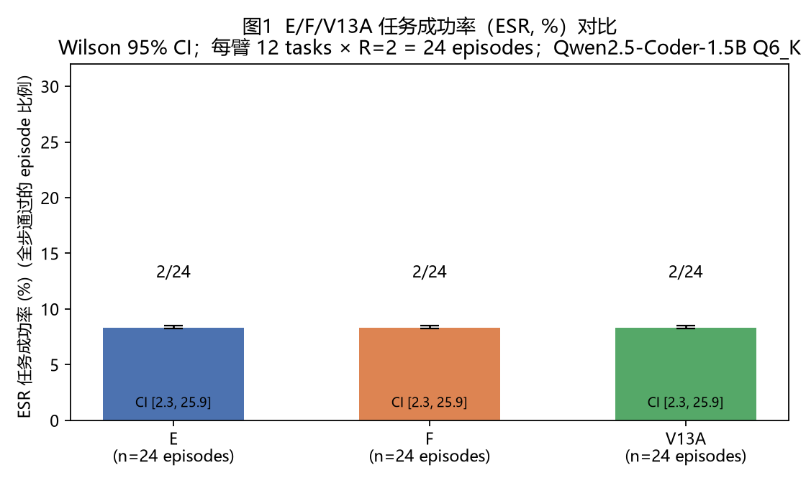
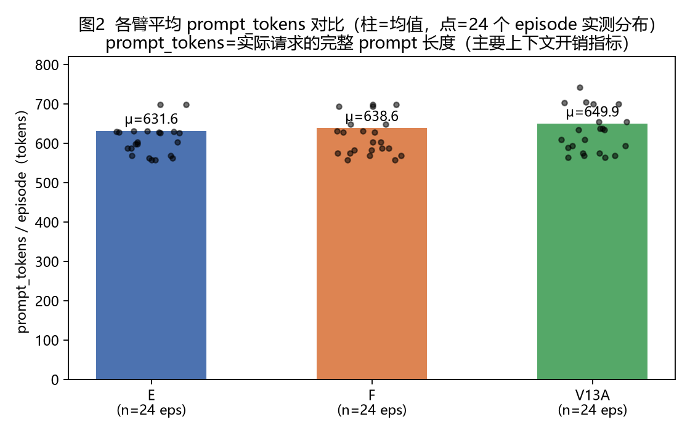
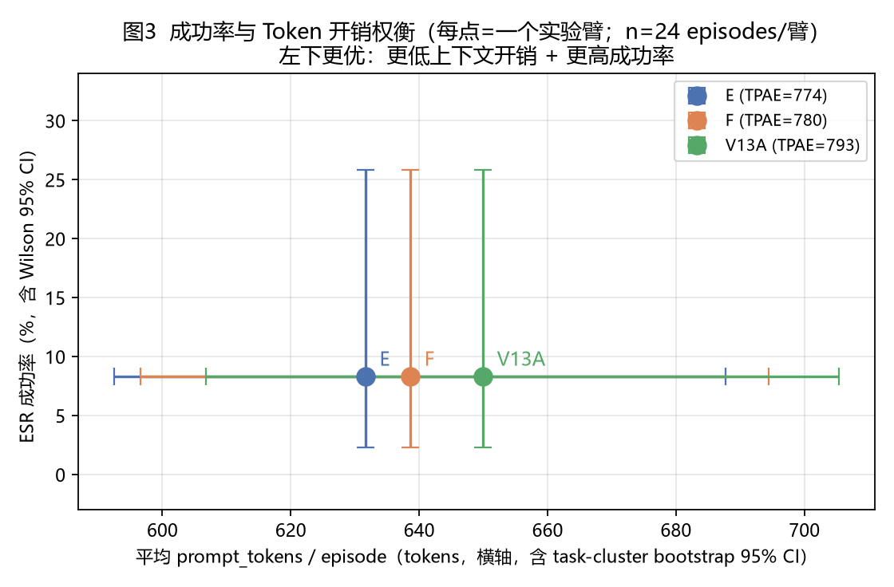
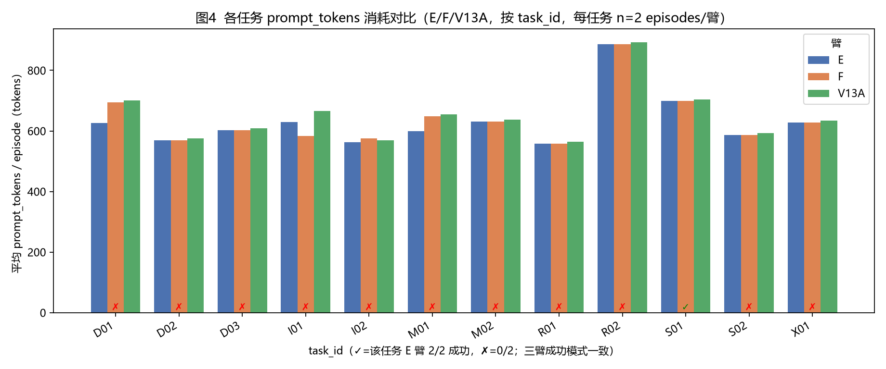
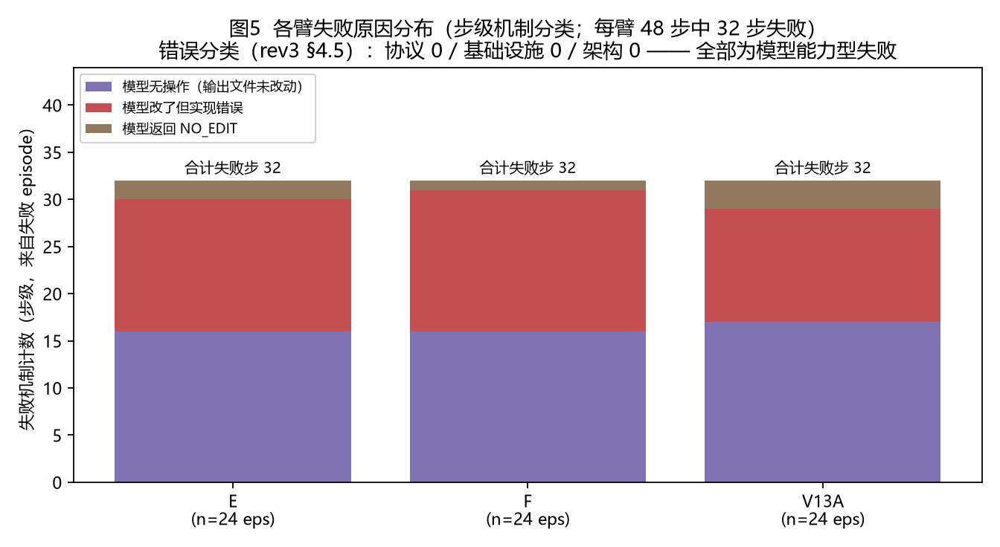
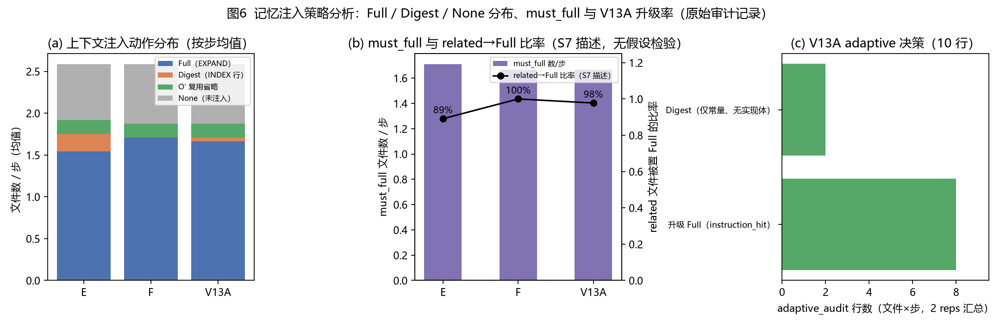
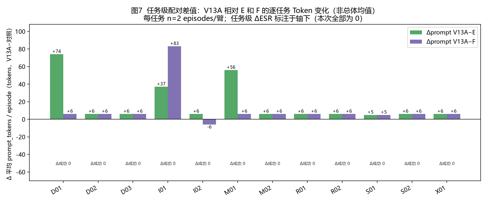

# VAM-Coder V1.3 / V13A 首轮真实模型实验报告（Empirical Validation Round 1）

状态：**完成**。本报告全部数据可追溯到 `episode_id` / `task_id`（`episode_logs/`、`raw_results.csv`）。
设计依据：`v13_m2_validation_plan_rev3.md`（sha256 `8ceed45d6554ba952a641fbbebb49b4f3eb0f69858c16ba9d58d7025eb9ee13f`，开跑前实测一致）。
统计：bootstrap seed=20261102、B=10000、聚类单位 task_id；随机化 seed=20261103（仅 episode 顺序）。

---

## 1. 实验环境

| 项 | 实测值 |
| --- | --- |
| 模型 | Qwen2.5-Coder-1.5B-Instruct，`qwen2.5-coder-1.5b-instruct-q6_k.gguf`（Q6_K，1.78B params） |
| 服务 | llama-server（llama.cpp CUDA），`http://127.0.0.1:8080/v1/chat/completions` |
| 上下文 | n_ctx=8192，n_slots(parallel)=1 |
| 解码 | temperature=0，seed=0，max_tokens=1024 |
| 历史策略 | keep（max_history_chars=24000，不切换 redact） |
| 闭包 | d=2，K_max=8，budget=4096（配置冻结值） |
| 运行时 | `D:\IDE_Env\Python\python` 3.12.10（MIMO_PYTHON 缺 tree_sitter，未使用） |
| Prompt 冻结核验 | SYSTEM_PROMPT `4f591635…`、`build_messages` `f0b477b0…`、`p1_common.py` `e32fd305…` 三项与 rev3 §3.1.1 完全一致（`run_meta.json` 已记录，不一致即停的门闩通过） |

**Token 字段语义**（Preflight 实测确认）：

- `prompt_tokens` = llama-server 报告的**完整请求 prompt 输入长度**（= Prefill \(P_s\) 主指标）。
- `completion_tokens` = 生成长度；`total_tokens = prompt + completion`。
- `cached_tokens` 取自 `usage.prompt_tokens_details.cached_tokens`，与 `prompt_tokens` **分列记录**（三臂合计 8797 / 8257 / 8001）。它是 llama-server **服务端前缀缓存**命中数，**不得**解释为 VAM KV Cache 节省量；本报告不作此解释。

**Preflight 结论**（最小必要检查，见 `experiment_config.json#preflight`）：模型加载✓、模型 ID/量化✓、ctx8192✓、接口与字段映射✓、三臂 dry-run 全部可运行✓、自动评测链路✓（holdout 72/72 dry-run：0 INSUFFICIENT、0 pre_send 失败、144 步目标解析与冻结 `expected_edit_targets` 100% 一致）。V13A 代码无需修改即可运行，无阻断。

## 2. 任务集概况

12 个**全新** Holdout 任务，创建于 `p1/tasks_v13_holdout/`，**先于任何模型请求冻结**：

- 类型配额按原计划 §2.2 十二行清单固定（S01/S02/M01/M02/D01/D02/D03/R01/R02/I01/I02/X01）；难度 短/中/长 = 4/4/4。
- 冻结前验证全部通过：eval 初态失败、参考解通过、step2 具备区分度、目标解析符合预期、**与 v1 24 任务文件 hash 交集 = 0**、指令与 v1 **零逐字复用**。
- 冻结哈希：`holdout_tasks.json` `59cebdd9…f4d4`，`holdout_manifest.json` `fcb8762f…9c05`；开跑前由 orchestrator 逐项复核（S3 门闩通过）。
- 每任务 2 步（共 24 步），行为断言 pytest 评测；每臂每任务 2 次重复（R=2）。

## 3. 实际运行规模

| 项 | 计划 | 实际 |
| --- | --- | --- |
| Episodes | 72（12×3×2） | **72/72 全部执行**（`execution_log.jsonl` 无跳过、无删除） |
| 模型请求 | ≤144 | **144**（每步恰好 1 次，无 INSUFFICIENT 跳过、无重试） |
| 累计 Token（P+C） | 计划 est 42k；S5 阈值 84k（字面执行，用户裁定） | **56,337**（未触发 S5） |
| 随机化 | seed=20261103 | `randomization_manifest.json` 已写入 72 顺序 |
| 运行耗时 | — | 三臂 episode 均值 E 4.85s / F 4.60s / V13A 4.51s；全 run 约 5 分钟 |

**停机表执行结果**（rev3 §5.2）：

- S1 安全：未触发（pre_send 全 ok、INSUFFICIENT=0、DHO=0、must 无丢失/降级记录）。
- S2 server：未触发。S3 冻结：未触发。S5 Token：未触发（56337 < 84000）。S6：未触发（ESR(V13A)=ESR(E)，不满足 < −0.10 条件）。
- **S4 触发**：失败率 66/72 = 91.7% > 50%（全 run 窗口）→ 按表执行动作“查 harness”，见 §7.1 排查结论：**未发现 harness 故障**，失败全部可追溯到模型输出本身。
- S7：仅描述性（§6.4），不参与停止。

## 4. 实验结果

主表（臂级，n=24 episodes/臂、48 steps/臂；`metrics_summary.csv` scope=arm）：

| 指标 | E | F | V13A |
| --- | ---: | ---: | ---: |
| **ESR**（全步通过率） | 0.0833（2/24） | 0.0833（2/24） | 0.0833（2/24） |
| ESR Wilson 95% CI | [0.023, 0.259] | [0.023, 0.259] | [0.023, 0.259] |
| **SPR**（步通过率） | 0.3333（16/48） | 0.3333 | 0.3333 |
| **prompt_tokens 合计** | 15,158 | 15,326 | 15,598 |
| **prompt_tokens 均值/episode** | 631.6 | 638.6 | **649.9** |
| prompt_tokens 均值/请求 | 315.8 | 319.3 | 325.0 |
| completion_tokens 合计 | 3,428 | 3,389 | 3,438 |
| cached_tokens 合计（单列，非 KV 节省） | 8,797 | 8,257 | 8,001 |
| **TPAE**（total/尝试） | **774.4** | 779.8 | 793.2 |
| **TPSE**（total/成功） | **9,293.0** | 9,357.5 | 9,518.0 |
| FETC_mean（失败步均耗） | 764.8 | 770.5 | 784.7 |
| 平均请求次数/episode | 2.00 | 2.00 | 2.00 |
| 平均执行耗时/episode | 4.85s | 4.60s | 4.51s |
| INSUFFICIENT 比例 | 0 | 0 | 0 |
| Protocol error 比例 | 0 | 0 | 0 |
| 架构安全事件（VP 违规仍请求 / must 丢失 / DHO） | 0 | 0 | 0 |

**任务通过模式（三臂完全一致）**：仅 `v13_S01` 两步全过（每臂 2/2）；`v13_S02` 仅 step2 过；`v13_I02/M01/M02/R02/X01` 仅 step1 过；`v13_D01/D02/D03/I01/R01` 两步全败。

**rev3 §4.2 效果点估计门（如实判定）**：

| 门 | 判定 |
| --- | --- |
| ESR(V13A) ≥ ESR(E)−0.05 | **通过**（0.0833 ≥ 0.0333；实际相等） |
| ESR(V13A) ≥ ESR(F)−0.05 | **通过**（相等） |
| TPAE(V13A) ≤ TPAE(F) | **未通过**（793.2 > 779.8） |
| TPAE(V13A) ≤ 1.02×TPAE(E)=790.1 | **未通过**（793.2，超出 3.1） |

## 5. 统计分析

Task 聚类配对 Bootstrap：seed=20261102，B=10000，同 task 全部 rep+全部臂整体重采样（72 episodes ≠ 72 独立样本）。完整结果 `bootstrap_results.csv`。

**臂级 95% CI（bootstrap）**

| 臂 | ESR 点估计 [CI] | TPAE [CI] | prompt/ep [CI] | TPSE [CI]，NA 样本占比 |
| --- | --- | --- | --- | --- |
| E | 0.0833 [0, 0.250] | 774.4 [703.4, 871.3] | 631.6 [592.5, 687.7] | 9,293 [2,984, 10,300]，NA=35.37% |
| F | 0.0833 [0, 0.250] | 779.8 [705.0, 877.9] | 638.6 [596.6, 694.4] | 9,358 [2,978, 10,359]，NA=35.37% |
| V13A | 0.0833 [0, 0.250] | 793.2 [716.6, 890.2] | 649.9 [606.8, 705.3] | 9,518 [3,025, 10,520]，NA=35.37% |

**配对差值（V13A vs 对照）**

| 比较 | ΔESR [CI] | ΔTPAE [CI] | Δprompt/ep [CI] | ΔTPSE [CI]（NA=35.37%） |
| --- | --- | --- | --- | --- |
| **V13A − E** | 0.000 [0, 0] | **+18.75 [+2.63, +37.67]** | **+18.33 [+6.00, +32.25]** | +225 [+11.9, +410.2] |
| **V13A − F** | 0.000 [0, 0] | +13.38 [−5.29, +43.25] | **+11.33 [+3.00, +25.17]** | +160.5 [−50.5, +488.0] |
| F − E | 0.000 [0, 0] | +5.38 [−14.71, +23.25] | +7.00 [−7.67, +22.50] | +64.5 [−155.0, +256.0] |

判读要点：

1. **ΔESR 全部恒为 0，CI=[0,0]**：任务级成功模式三臂完全一致（bootstrap 每个重采样内差值均为 0）。这不等于“证明等效”，而是**当前任务×模型组合的成功率没有区分度**（见 §9 局限）。
2. **Δprompt(V13A−E) 与 Δprompt(V13A−F) 的 95% CI 均 > 0**：本轮 V13A 是**最贵**的臂，方向与“降开销”假设相反。
3. TPSE 的 NA 规则严格执行：零成功 bootstrap 样本 = NA（占比 35.37%，因唯一成功任务 S01 未被抽中即全臂零成功），**未记 0**；同时以 TPAE 作稳定替代披露。
4. R=2 为探索性证据；**温度 0 下 72 步中 64 步的 (prompt, completion, eval) 两次重复完全一致**，8 处差异仅为 completion 长度抖动且 eval 结果零差异——有效独立信息接近 12 任务 × 3 臂 × 1 次，统计功效远低于名义样本量（详见 §9）。

## 6. 图表（全部由本次实验原始记录生成）

数据来源：`raw_results.csv`（144 步）、`metrics_summary.csv`、`bootstrap_results.csv`、`failure_analysis.csv`、`episode_logs/**/injection_audit.jsonl`。生成脚本 `make_figures_v13.py`（未平滑、未截断坐标轴以美化任何一臂）。

### 图1 E/F/V13A 成功率对比

三臂 ESR 均为 2/24=8.3%（Wilson 95% CI [2.3, 25.9]），柱上标注分子/分母与 CI。唯一全通过任务为 v13_S01。

### 图2 三组平均 prompt_tokens 对比

柱=均值（E 631.6 / F 638.6 / V13A 649.9），散点=各臂 24 个 episode 实测分布（无平滑）。V13A 分布整体右移。

### 图3 成功率与 Token 开销权衡

横轴 prompt_tokens/episode（含 task-cluster bootstrap 95% CI），纵轴 ESR（含 Wilson CI）。三臂纵向完全重叠（ESR 无差异），横向 V13A 最靠右（最贵）。图例附 TPAE。

### 图4 各任务 Token 消耗对比

按 task_id 分组的三臂平均 prompt_tokens（每格 n=2 episodes/臂）。任务间差异显著（R02 最高 ≈890，R01 ≈560）；轴下 ✓/✗ 标注 E 臂任务级成功（三臂成功模式一致）。V13A 显著高于 E 的任务集中在 D01/M01/I01。

### 图5 各组失败原因分布

步级机制分类（来自 `failure_analysis.csv`）：每臂 48 步中 32 步失败，机制为 模型无操作 49 / 改了但实现错误 41 / NO_EDIT 6（三臂合计 96）。rev3 §4.5 错误分类：protocol 0、infrastructure 0、architecture 0——**全部为模型能力型失败**。

### 图6 记忆注入策略分析

(a) 按步注入动作均值：Full/step E 1.542、F 1.708、V13A 1.667；Digest/step E 0.208、F 0、V13A 0.042；O′ 复用省略三臂各 8 次。
(b) must_full 数/步与 S7 描述统计（related→Full 比率 E 89% / F 100% / V13A 98%）——**仅描述，无假设检验、不参与停止**。
(c) V13A adaptive_audit 共 10 行：升级 Full 8 行（全部 reason=instruction_hit）、降级 Digest 2 行（catalog_meta 仅常量无实现体）。
**同口径事实**：非 must、非目标的 related 文件实例共 10 个——E 全部 Digest（10/10），F 全部 Full（10/10），V13A Full 8 + Digest 2。

### 图7 任务级配对差值

逐任务 Δprompt（V13A−E、V13A−F），非总体均值。+74/+56/+37（D01/M01/I01 相对 E）与 +83（I01 相对 F）为主要增量；其余任务稳定 +6。轴下标注任务级 ΔESR——**全部为 0**。

**+6 基线的归因（原始数据实证）**：S02/R02/D02 等无 adaptive 触发的任务上，V13A 每步 prompt 恰比 E/F 多 3 token（如 S02 step1：E=246、F=246、V13A=249；step2：341/341/344）。来源是上下文首行臂名长度差异 `[ctx] v1.2-V13A` vs `[ctx] v1.2-E`（+3 字符级 token/步 ×2 步 ≈ +6/episode），**属于测量伪影而非注入策略开销**；策略真实增量集中在 D01/M01/I01（单位全量文件 ≈31–66 tok/步）。

## 7. 失败案例与 harness 排查

### 7.1 S4 触发后的 harness 排查（动作=查 harness，非停机）

| 检查项 | 结果 | 证据 |
| --- | --- | --- |
| 协议违规（非 FILE/NO_EDIT 响应） | **0**（138 FILE + 6 NO_EDIT / 144） | 逐 `episode_logs/**/response.txt` 扫描 |
| pre_send 失败后仍请求 | **0**（pre_send ok=144/144） | `raw_results.csv.pre_send_ok` |
| INSUFFICIENT 误发 | **0** | `raw_results.csv.insufficient` 全 0 |
| DHO（编辑目标被省略） | **0** | `raw_results.csv.dho` 全 0 |
| eval 链路 | 冻结前已验证（初态必败/参考解必过）；失败步的 pytest 输出逐例可读 | `episode_logs/**/eval_output.txt` |
| 应用链路 | FILE 块全部解析成功，`apply.json.rejected` 为空 | `episode_logs/**/apply.json` |
| 模型可复现性 | 64/72 步 R1≡R2，eval 结果 100% 一致 | `raw_results.csv` 按 rep 对比 |

结论：**S4 的 91.7% 失败率不是 harness 故障**，全部失败步可归因到模型输出（rev3 §4.5 无对应“架构失败”项；按规则不得记为 architecture failure）。

### 7.2 代表性失败案例（机制与证据路径）

| 案例 | episode（代表） | 机制 | 原始证据 |
| --- | --- | --- | --- |
| **无操作回传**（最多） | `v13_M01_E_R1` step2 | 模型原样回传 `pad = rjust`，要求的右对齐未实现 | `episode_logs/v13_M01_E_R1/.../steps/step2/response.txt`（内容与 project 初态逐字节相同） |
| **有表也不改**（I01） | `v13_I01_V13A_R1` step1 | V13A 已把 `curves_body.py`（含 10 项系数表）升 Full 注入；模型把曲线文件完整抄写进 FILE 块，却让 `engine.quote` 保持 `return t * 2` | 同目录 `steps/step1/response.txt`；F 臂 `v13_I01_F_R1` 则只回传 31 字符函数片段（原文件 91 字符） |
| **空引用杜撰**（I01-E） | `v13_I01_E_R1` step1 | E 臂只见 `--- INDEX curves_body.py [calibrate] ---`，模型杜撰 `return t * curves_body.calibrate(t)`（无 import，运行必错） | `.../v13_I01_E_R1/.../steps/step1/response.txt` |
| **依赖公式算错**（D01） | `v13_D01_V13A_R1` step1 | V13A 已 Full 注入 `units.py`（MARGIN=0.1 可见），模型写成 `(w+MARGIN)*(h+MARGIN)` 而非 `w*h*(1+MARGIN)` | `.../v13_D01_V13A_R1/.../steps/step1/response.txt` + `eval_output.txt` |
| **部分文件覆盖**（fragment） | `v13_D02_E_R1` step1（6/6 episode 均如此） | 模型只输出 `normalize` 函数 47 字符，整文件被覆盖（原 138 字符），`fields`/`squash` 导入被抹掉；且未保留压缩空白语义 | `.../v13_D02_*_R*/.../steps/step1/response.txt` |
| **NO_EDIT 拒绝新增** | `v13_D02_*` step2（5 例）、`v13_R01_V13A_R2` step2 | 面对“新增 bulk/…”，模型返回 NO_EDIT（协议合法但任务失败） | `failure_analysis.csv.mechanisms=model_no_edit` |
| **结构细节遗漏** | `v13_R01_E_R1` step1 | 写了 `HISTORY[k].append(v)` 未做 `setdefault`，KeyError | `.../steps/step1/eval_output.txt` |
| **子条件遗漏** | `v13_S02_*` step1（6 例） | 处理了空白→0，遗漏“负数→0”，`int("-5")=-5` | `.../steps/step1/response.txt` |

失败步机制总量（步级，三臂合计 96）：模型无操作 49、改了但实现错误 41、NO_EDIT 6；其中整文件被片段覆盖 9 例（D02×6、I01×3）。**没有任何一个失败步可归因于“关键文件没有注入 / Digest 摘要丢失 / INSUFFICIENT / 协议错误”**——例如 D01、I01 在 F/V13A（关键内容全量在上下文中）同样失败，I02 step1 在 E（仅 Digest）全部通过。

## 8. 架构诊断（对照 §八 九问）

**1) V13A 的收益来自哪一类任务？**
本轮没有 token 收益（V13A 三臂最贵）。相对 F 的唯一下降点在 `v13_I02`（相关文件仅常量 → V13A Digest 而 F Full，任务级 −6 tok/episode，见图7），与设计预期“常量文件偏 Digest”一致，但量级被 D01/M01/I01 的升级（+74/+56/+83）完全淹没。原始证据：`metrics_summary.csv` scope=task_arm；代表 episode `v13_I02_V13A_R1`。

**2) 哪些任务出现成功率下降？**
无。三臂 12 任务成功模式逐一相同（图7 轴下 Δ成功全 0；`bootstrap ΔESR=0 [0,0]`）。RQ2 回答：**V13A 未出现成功率下降**——但因 ESR 地板（8.3%），这是“低水平持平”，非“非劣性证实”。

**3) 哪些文件被错误降级或遗漏？**
降级（相对 F）共 2 例：`catalog_meta.py`（I02 step1，仅常量 → V13A 判 `no_implementation_body` 正确降级且任务通过）、`stream.py`（M02 step2，V13A 原判 Digest，但实际执行中该文件因模型 step1 改动进入 must 而被强制 Full——dry-run 与真实 run 差异源于模型输出改变依赖图）。遗漏类：**DHO=0，无编辑目标遗漏**。E 臂降级 `units.py`（D01）与 `curves_body.py`（I01）在本轮**未构成失败原因**（F/V13A 全量注入同样失败）。

**4) Digest 是否真的帮助模型？**
证据不足以宣称帮助，但**未造成可归因伤害**：I02 step1（E 仅 Digest 相关文件）6/6 通过；E 与 F 的失败集合完全相同——把 Digest 换成 Full（F）没有救回任何一个任务。即：**在 1.5B 上，Digest→Full 的信息增量不是瓶颈**。

**5) Full 是否存在明显过度注入？**
有结构性浪费但本轮代价很小：F 对 10/10 related 非目标文件全部 Full（含 I02 常量文件、M01 与本步无关的 pretty.py），F−E = +7.0 tok/episode（CI 跨 0）。同型问题在 V13A 也存在：M01 step1 中 `pretty.py` 因指令提及被升 Full（`adaptive_a_full:instruction_hit:path_token`，`v13_M01_V13A_R1`），而该文件与本步任务无关——**instruction_hit ≠ 信息有用**，存在“提及即全量”的过度注入。

**6) None 是否导致关键上下文缺失？**
本轮未发现。所有任务的无关文件（notes/cli2/registry/reportx/audit_log 等）NONE 后，参考解与评测均不依赖它们；无失败步的机制指向缺失 NONE 文件。

**7) V13A 是减少了上下文 Token 还是把成本转移到其他环节？**
**是后者（且净增）**。V13A−E 的 +18.3 tok/episode 分解为：约 **+6 为臂名头部伪影**（§6 图7 归因，S02/R02/D02 无升级任务恒 +6）；约 **+12 为真实升级注入**（集中 D01/M01/I01）。此外存在**历史转移成本**：升级让 step1 响应变长，而 history=keep 会把 assistant 响应原样带入 step2 prompt——最典型 `v13_I01`：V13A step1 响应 158 token（抄写曲线文件）→ step2 prompt 膨胀，任务级 V13A−F = **+83**。即注入侧省下的/多花的钱，部分在生成侧与历史里被重新计费。

**8) 哪些失败是架构问题，哪些是模型能力问题？**
96 个失败步全部为模型能力问题（noop 49 / 实现错误 41 / NO_EDIT 6；protocol/architecture/infrastructure = 0）。架构侧本轮暴露的是**缺陷而非失败归因**：(a) `from mod import CONST` 类常量 import 不产生依赖边（store 符号索引仅含函数/类，D01 中 `units.py` 因此不在 must 闭包，靠指令提及被 V13A 升 Full 补救——若指令未提及，三臂都会拿不到 MARGIN 值）；(b) adaptive 规则中 `dependency_touch` 分支对“非 must 的 related 文件”**永远为 false**（其闭包与 must 闭包同构），10 行 audit 全部由 `instruction_hit` 驱动；(c) 臂名头部 token 伪影污染配对差值；(d) 模型整文件片段覆盖无护栏（9 例，harness 原样落盘）。

**9) 是否存在明显的任务类型交互效应？**
Token 侧有：升级型增量只出现在“指令提及非目标文件”的类型（D01 依赖、M01 无依赖、I01 实现体）；I02（常量）方向相反（V13A<F）。成功率侧**无法讨论交互**——零方差（三臂全同）。

**S7 描述性输出（不作判定）**：related→Full 比率 E 89% / F 100% / V13A 98%；V13A audit 行中 reason 含 hit 的比例 8/10=80%；n 小，只报计数，不写显著。

## 9. 下一轮优化建议（数据驱动，禁止仅凭主观修改）

### A. 保留（本轮数据支持）

| 机制 | 证据 | 预期维持指标 |
| --- | --- | --- |
| ET/C/must 强制 Full + 发送前强制校验 + INSUFFICIENT 门闩 | DHO=0、pre_send 144/144 ok、0 误发请求 | 安全类指标保持 0 违规 |
| O′ 历史复用省略 | 三臂各 8 次 `REUSE_KV`（如 `v13_M02_*_R1` step2 省略 stream.py，内容已在 step1 响应中可见），step2 prompt 未因此膨胀 | TPAE 不升、RSR 满足 |
| adaptive 保守降级（uncomputable → Digest） | `adaptive_a_digest:no_implementation_body` 2 行，I02 通过 | 降级不引入失败 |
| 评测与冻结协议（初态必败/参考必过/哈希门闩） | 本轮全部通过；S3/§3.1.1 门闩零触发 | 复现性 |

### B. 修改（有原始数据支撑）

| # | 发现（证据） | 建议修改 | 对应架构组件 | 预期改善指标 | 可能新风险 |
| --- | --- | --- | --- | --- | --- |
| B1 | **常量 import 无依赖边**：D01 中 `units.py` 不在 must（`from units import MARGIN` 无法解析到符号），E 臂该文件只剩 Digest，本轮靠指令提及“碰巧”补救 | store/parser 为“模块级 import 落到未索引名字”补建**文件级边**；must 闭包按文件边回退 | `dependency_closure`（levels.py）/ store 索引 | 关键常量提供方 must 覆盖率↑；指令未提及时 E 臂 DHO 风险↓ | 闭包变大→prompt_tokens↑（与降本目标反向），需预算复核 |
| B2 | **臂名头部 +3 tok/步伪影**：无升级任务 V13A−E 恒 +6/episode（S02/R02/D02 原始行） | 上下文首行改用**等长臂标识**（或去臂名），使配对 Token 差只反映注入策略 | `assemble_v12` 的 `[ctx]` 头 | Δprompt 纯净化（V13A−E 基线归零） | 无行为风险；属测量修正，需预注册变更 |
| B3 | **instruction_hit 过度注入**：M01 step1 与本步无关的 `pretty.py` 因提及被升 Full（`v13_M01_V13A_R1` audit） | hit 升级增加“相关性二次判定”（如提及子句为否定/旁注则仍 Digest；或限定提及须伴随编辑动词） | `adaptive_features.instruction_hit` | 无用 Full 次数↓，TPAE(V13A) 向 E 收敛（目标 ≤E×1.02） | 可能漏升真正有用但仅被间接提及的文件（如 I01 型），需 A/B 验证 |
| B4 | **dependency_touch 分支对非 must related 永不触发**（10 行 audit 全为 hit；dtouch 闭包与 must 闭包同构） | 文档与实现二选一：要么显式标注该分支仅覆盖 must 漏网情形（当前=0），要么重新定义独立于 must 的 touch 图 | `adaptive_features.dependency_touch` | 规则可测性↑（S7 归因更干净） | 若重定义可能扩大 Full 集 |
| B5 | **整文件片段覆盖无护栏**：9 例模型只回传函数片段导致文件被截断（D02×6、I01×3；`v13_D02_E_R1` 138→47 字符） | 预发送校验增加“输出文件长度/AST 结构骤降”告警或拒收重问（**注意 rev3 冻结：无自动重试**——本轮仅建议记录为诊断位，实施须下轮预注册） | apply/verify 链路 | fragment 类失败可识别、可归因 | 若拒收改变成功率口径，须重新预注册 |

### C. 删除

**本轮不建议删除任何组件。** 理由：ESR 处于地板（8.3%），零方差数据无法证明任何组件“无用”（method §6.4 的 H 消融方向判据在零区分度下不可判）。对 `dependency_touch` 分支的处理归入 B4（先澄清再议删除）。

### D. 下一轮需要验证（不进入本轮结论）

1. **能力地板问题是首要变量**：换 ≥7B 指令模型或下调任务难度（两步→单步、单条件），使 ESR 离开地板，否则任何注入策略差异都无法在成功率上显影。
2. **扩大任务/重复数**：R=2 在温度 0 下近乎复制（64/72 步完全一致）；若模型不变，应增加任务数而非重复数；Token 类差值（±11~19 tok）需要更大任务面才能缩窄 CI。
3. B1–B3 修改各自单独预注册后再测；S5 基线口径（§5.1 的 42k est 与实测 56k 的差距）下轮开跑前重新锚定并写入 run_meta。

## 10. 实验局限

1. **R=2 探索性且高度重复**：温度 0 + 短任务使两次重复几乎复制（eval 结果 100% 重复），名义 72 episodes 的有效信息量接近 12×3；CI 宽（ESR 臂 CI 宽 25 个百分点）。
2. **单一模型、单任务集、单种子**：Qwen2.5-Coder-1.5B 是能力地板的直接来源；结论不可外推到更大模型或其他任务分布。
3. **ESR 地板导致零区分度**：ΔESR=0[0,0] 反映的是“大家都过不了”，不是“策略等效”；RQ2 的“成功率保持”只在低水平成立。
4. **Token 差值量级小**（±11~19/episode，约 2–3%），头部伪影（+6）占 V13A−E 差值的约三分之一；解释需带分解。
5. **S4 触发过**（91.7% 失败率）：按协议完成了 harness 排查且无故障发现，但高失败率使效率类指标（TPSE/TPSE CI）建立在 2 个成功任务之上，TPSE 的 35.37% NA 样本即源于此。
6. `cached_tokens` 受 llama-server 前缀缓存与请求顺序（已随机化）共同影响，仅作分列描述。
7. S5 口径为用户裁定的“P+C 合计 84k 字面执行”；rev3 §5.1 原 est（42k）与冻结环境不匹配的问题**未被修改设计**，仅记录（`experiment_config.json#budget`）。

## 11. 最终判断（对照任务书 §十五种结果）

**本轮落入“结果 3 + 方向反转”：V13A 与 E/F 无成功率差异，但 Token 并未更少、反而显著更贵（ΔTPAE V13A−E CI 下界 +2.63，Δprompt V13A−F CI 下界 +3.00），且 rev3 §4.2 的两项 TPAE 门未通过。**

- 用数据回答“V13A 是否值得继续研究”：**在当前形态（1.5B + 本 holdout）下，没有证据支持继续扩大 V13A 验证**——核心假设（降低 prompt 开销）在本方向上被否定，成功率假设只在地板水平上“未变差”。
- 不应包装为成功：唯一成功任务三臂全同；升级注入 8 次中可识别的“有用”案例 0 次（I01 型即使内容在场模型也不改）。
- 若重启研究，前置条件按顺序为：(1) 解决模型能力地板（B/D1）；(2) 执行 B1–B3 的预注册修正（依赖边、头部伪影、hit 过度注入）；(3) 重新锚定预算与 S5 口径。**在此之前不进入扩大样本验证。**
- 按任务书要求：**本阶段到此停止**，不自动开始下一轮架构修改或实验。

## 12. 交付物与追溯

| 交付物 | 路径 |
| --- | --- |
| holdout_tasks.json | `p1/tasks_v13_holdout/holdout_tasks.json`（sha `59cebdd9…`） |
| holdout_manifest.json | `p1/tasks_v13_holdout/holdout_manifest.json`（sha `fcb8762f…`） |
| experiment_config.json | `p1/experiments/v13_holdout_validation/experiment_config.json` |
| raw_results.csv | 同目录（144 行步级，含 episode_id/task_id/arm/rep/step、P/C/cached、注入与安全字段） |
| episode_logs/ | 同目录（72 episode：workspace 前后证据、steps 响应/评测/审计、runner per_step.csv） |
| metrics_summary.csv | 同目录（3 臂 + 36 task×arm 行） |
| bootstrap_results.csv | 同目录（seed=20261102、B=10000、cluster=task_id、NA 占比） |
| failure_analysis.csv | 同目录（66 失败 episode，机制+错误分类+证据路径） |
| figures/ | 同目录 fig1–fig7（由 `make_figures_v13.py` 从原始记录生成） |
| experiment_report.md | 本文件 |
| 支撑元数据 | `run_meta.json`（冻结哈希）、`randomization_manifest.json`、`execution_log.jsonl`、`execution_summary.json`、`analysis_manifest.json` |

**追溯约定**：任一结论可用 `episode_id`（= `task_id_arm_Rrep`）定位到 `episode_logs/<episode_id>/runner_out/episodes/<task_id>/<baseline>/steps/<step>/` 下的 `response.txt`、`eval_output.txt`、`context.txt`、`pre_send_check.json`、`result.json` 与 `<baseline>/logs/injection_audit.jsonl`；步级汇总见 `raw_results.csv`（同键列）。
