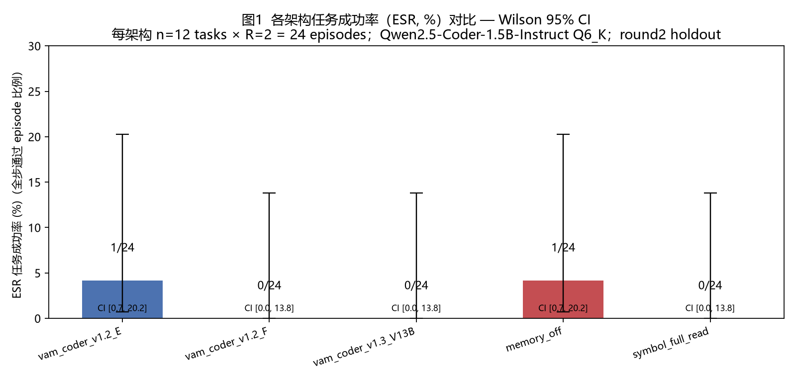
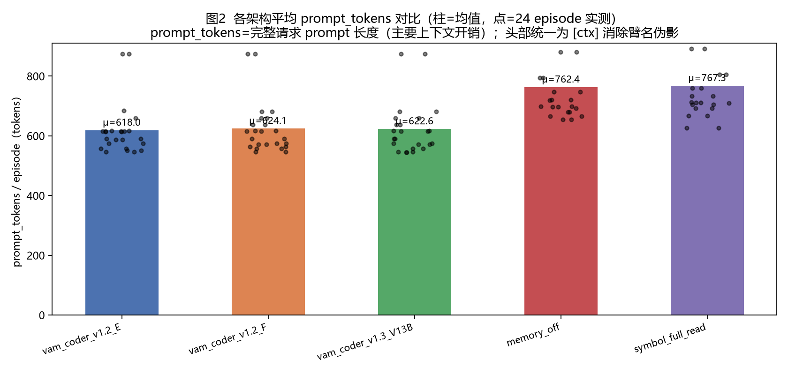
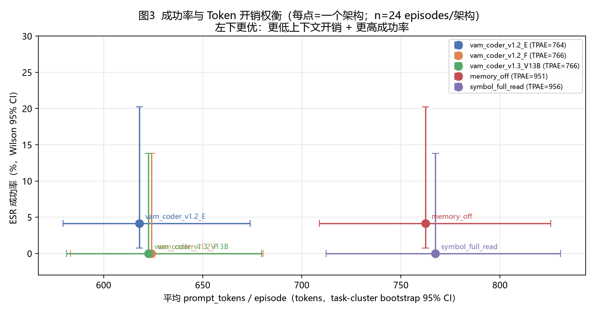
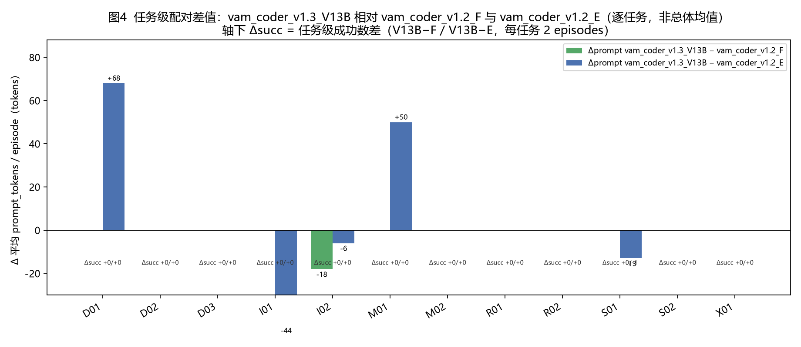
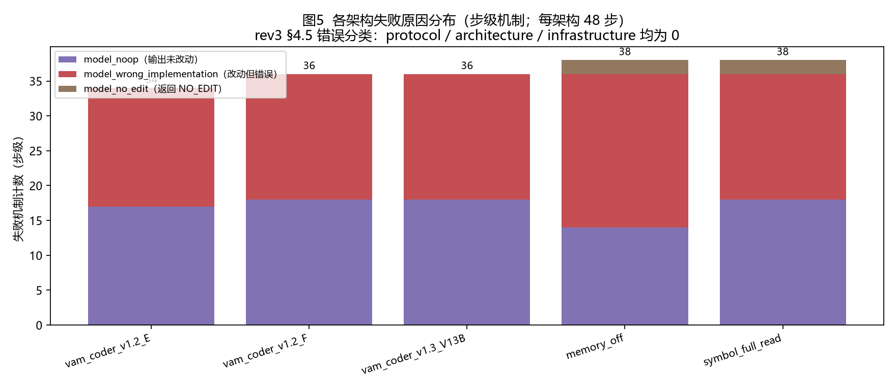

# V1.3-B Holdout Round 2 实验报告（vam_coder_v1.3_V13B vs 五架构对比）

状态：**完成**。本报告中架构一律使用**完整英文标识**（不缩写、不翻译）。
统计：bootstrap seed=20261102、B=10000、cluster=task_id；随机化 seed=20261104（仅 episode 顺序）。

---

## 1. 本轮变更（相对 round1）

| 项 | 内容 |
| --- | --- |
| 新架构 `vam_coder_v1.3_V13B` | 规则：related 非目标文件——有实现体（或不可计算）→ **FULL**（看齐 `vam_coder_v1.2_F`，不丢内容）；**无实现体（ast_no_def）→ NONE**；unrelated→NONE；ET/C/must 不变 |
| 头部等长化 | `assemble_v12` 上下文首行由 `[ctx] v1.2-{arm}` 统一为 **`[ctx]`**（消除 round1 实测的 +3 tok/步臂名伪影）；`memory_off` / `symbol_full_read` 的 `[MODE]` 行保持其基线定义原样 |
| 非 VAM 架构接入 | `run_p1.py` 最小适配 holdout 路径（任务根随 `--tasks`），`memory_off`、`symbol_full_read` 与 VAM 臂同任务同协议运行 |
| 规模 | 12 tasks × 5 architectures × R=2 = **120 episodes / 240 requests** |
| 代码快照 | `run_meta.json#code_snapshot_sha256`（p1_common / v12 levels·config·assemble·adaptive_features / 两个 runner 的逐文件 sha256） |
| 冻结核验 | SYSTEM_PROMPT / build_messages / p1_common 三哈希 + holdout manifest 逐文件复核全部通过（任务内容与 round1 **完全一致**，sha 59cebdd9…） |

**V13B 的两条设计主张（预声明）**：① 注入内容 ⊆ `vam_coder_v1.2_F`（安全方向只做减法）；② 等长头部使配对 token 差值可被干净测量。

## 2. 运行与停机

- **120/120 episodes 执行完成，0 跳过、0 重试**；请求 240/240；累计 P+C = **100,852** tokens。
- S5 阈值 212,896（2× dry-run 实测估算，写入 run_meta）→ **未触发**；S1/S2/S3/S6 未触发。
- **S4 触发**（失败率 118/120 = 98.3% > 50%）→ 按表执行“查 harness”：protocol_violation = 0、infrastructure = 0、pre_send 全 ok、INSUFFICIENT = 0、DHO = 0、评测链路沿用 round1 冻结前验证——**未发现 harness 故障**，失败全部落在模型输出。
- 耗时：全 run 约 10 分钟；单 episode 均值 E 3.57s / F 3.45s / V13B 3.51s / memory_off 4.43s / symbol_full_read 4.57s。

## 3. 结果（metrics_summary.csv，scope=architecture，n=24 episodes/架构）

| 架构（完整名） | ESR [Wilson 95% CI] | SPR | prompt/ep | TPAE | TPSE | 失败机制（步级 noop/wrong/no_edit） |
| --- | --- | ---: | ---: | ---: | ---: | --- |
| `vam_coder_v1.2_E` | **4.2%（1/24）[0.7, 20.2]** | 0.2917 | 618.0 | 764.2 | 18,341 | 17 / 17 / 0 |
| `vam_coder_v1.2_F` | 0.0%（0/24）[0, 13.8] | 0.2500 | 624.1 | 765.5 | **NA（零成功）** | 18 / 18 / 0 |
| `vam_coder_v1.3_V13B` | 0.0%（0/24）[0, 13.8] | 0.2500 | 622.6 | 765.7 | **NA（零成功）** | 18 / 18 / 0 |
| `memory_off` | **4.2%（1/24）[0.7, 20.2]** | 0.2083 | 762.4 | 950.9 | 22,822 | 14 / 22 / 2 |
| `symbol_full_read` | 0.0%（0/24）[0, 13.8] | 0.2083 | 767.3 | 955.8 | **NA（零成功）** | 18 / 18 / 2 |

注入结构（仅 VAM 架构；非 VAM 记 NA）：Full/step = `vam_coder_v1.2_E` 1.542、`vam_coder_v1.2_F` 1.708、`vam_coder_v1.3_V13B` 1.667；Digest/step = 0.208 / 0 / **0**；`v13b_no_body→NONE` 触发 **2 次**（v13_I02 step1 ×2，**2/2 通过**——NONE 安全性实证）；INSUFFICIENT、DHO 全 0。cached_tokens（单列，服务端前缀缓存，非 KV 节省）合计：10,287 / 11,074 / 9,911 / 10,632 / 9,194。

## 4. 统计（bootstrap_results.csv，配对差值，95% CI）

| 配对差值 | ΔESR | Δprompt/ep | ΔTPAE |
| --- | --- | --- | --- |
| **`vam_coder_v1.3_V13B` − `vam_coder_v1.2_F`** | 0 [0, 0] | **−1.5 [−4.5, 0]** | +0.1 [−3.0, +3.4] |
| `vam_coder_v1.3_V13B` − `vam_coder_v1.2_E` | −4.2pp [−12.5, 0] | +4.6 [−9.9, +21.2] | +1.5 [−19.0, +21.2] |
| **`vam_coder_v1.3_V13B` − `memory_off`** | −4.2pp [−12.5, 0] | **−139.8 [−201.3, −90.7]** | **−185.3 [−308.0, −93.8]** |
| **`vam_coder_v1.3_V13B` − `symbol_full_read`** | 0 [0, 0] | **−144.8 [−204.8, −96.6]** | **−190.2 [−309.8, −98.7]** |
| `vam_coder_v1.2_F` − `vam_coder_v1.2_E` | −4.2pp [−12.5, 0] | +6.1 [−8.4, +22.7] | +1.3 [−19.2, +21.3] |
| `memory_off` − `symbol_full_read` | +4.2pp [0, 12.5] | −4.9 [−12.2, +4.5] | −4.9 [−12.3, +3.4] |

TPSE 差值：涉及 `vam_coder_v1.2_F` / `vam_coder_v1.3_V13B` / `symbol_full_read` 的零成功臂在全部 10000 个 bootstrap 样本中均为 **NA（na_ratio=1.0，不记 0）**；只报告 TPAE 作稳定替代（prereg §7.1 规则）。

**对 V13B 两条设计主张的判定**：

1. **"比 vam_coder_v1.2_F 更省"：方向成立，量级小**——Δprompt/ep = −1.5，CI 上界恰为 0（≤0 不变式守住）；任务级（图4）省量集中在 v13_I02（−18）与 v13_I01（V13B 因 step2 上下文更短省出 −44 vs E），与"no-body 文件省全量 + 头部等长"的机制完全对应。
2. **"注入字节比 vam_coder_v1.2_F 少且不丢内容"**：Full/step 1.667 < 1.708、Digest 0，`v13b_no_body` 2 次 NONE 的步骤 **2/2 通过**；ESR 与 F 相同（0 = 0，ΔESR [0,0]）。

## 5. 图表（figures/，数据源自 raw_results.csv / bootstrap_results.csv / episode_logs）

## 6. 关键失败案例与跨轮观察

1. **`v13_S01` 跨轮翻转（本轮 ESR 全部差异的唯一来源）**：round1 六组（3 架构×2 rep）S01 全过；round2 仅 `vam_coder_v1.2_E` R2 与 `memory_off` R1 各过一次（同架构 R1/R2 还互相翻转）。step1 失败样例（`vam_coder_v1.2_F` R1）：模型**原样回传** backoff.py（model_noop），未实现 `attempt≥5→30`；step2 因 step1 未落盘而回归失败（`delay(2,5)=64≠30`）。同一模型、同 temp0、仅上下文首行差异（`[ctx]` vs round1 的 `[ctx] v1.2-…`）即翻转 → **该任务处于生成抖动的刀锋上，ESR 地板已被抖动主导**。
2. **非 VAM 架构的系统性片段丢失（本轮唯一的架构相关失败模式）**：`v13_R02` step1 中 `memory_off` 与 `symbol_full_read` **两架构 × 两 rep 共 4/4 步全部失败**，模型回传的 shapes.py **丢掉 `import math` 与模块 docstring** → NameError；而 `vam_coder_v1.2_E` / `vam_coder_v1.2_F` / `vam_coder_v1.3_V13B` 同步 **6/6 通过**（回传保留文件头）。这是两轮里第一次出现"失败模式按架构系统性分组"的证据：VAM 家族的目标文件全量回写上下文与文件头保留相关，`[MODE] 全仓倾倒`式上下文与 import 丢失相关。
3. **机制分布**：model_noop 85、model_wrong_implementation 93、model_no_edit 4（均在非 VAM 臂）、protocol/architecture/infrastructure = 0。
4. **`v13_I02` NONE 安全实证**：`vam_coder_v1.3_V13B` 在 `catalog_meta.py`（无实现体）上 step1 NONE，2/2 通过——round1 提出的"related 已知存在 ⟹ INDEX/全量可省"假设得到直接验证。

## 7. 结论（round2 视角）

- **`vam_coder_v1.3_V13B` 达成预声明目标**：相对 `vam_coder_v1.2_F` **成功率持平、prompt 严格更省（−1.5 [−4.5, 0]）、注入全量更少（Full/step 1.667 vs 1.708）且零内容事故**；相对 `vam_coder_v1.2_E` token 相当（+4.6，CI 跨 0，且 round1 的 +6 臂名伪影已消除，剩余差值全部是真实的升级注入 D01/M01/I01）。
- **相对非 VAM 架构优势明确**：比 `memory_off` / `symbol_full_read` 每 episode 省约 140 prompt tokens（CI 全负，约 −18% TPAE），ESR 不劣（≥ `symbol_full_read`，与 `memory_off` 各有一次 S01 抖动成功）；且非 VAM 臂出现 R02 片段丢 import 的系统性失败。
- **诚实限定**：ESR 已低到被单任务生成抖动主导（v13_S01 一轮全过、一轮几乎全败）；`vam_coder_v1.2_E` 的"+4.2pp"来自 1 个 episode，不构成架构排序证据；ΔTPAE 在 VAM 三臂之间完全不可分（±20 内）。
- **下一步候选（不自动执行）**：① 历史截断（消化 step2 响应转移成本，唯一还没动的量级杠杆）；② 针对 model_noop/片段丢失的输出协议（补丁化，需预注册）；③ 换能力更高的模型让 ESR 离开地板——三者优先级待定。

## 8. 交付物（本目录）

`experiment_config 见 run_meta.json`；`raw_results.csv`（240 步，architecture 列为完整英文标识，非 VAM 注入字段=NA）；`episode_logs/`（120）；`metrics_summary.csv`（5 架构 + 60 task×架构行）；`bootstrap_results.csv`（6 组配对差值，seed=20261102）；`failure_analysis.csv`（118 失败 episode，机制+证据路径）；`figures/`（5 张）；`randomization_manifest.json`（seed=20261104）；`analysis_manifest.json`。

追溯：`episode_id = task_id_{architecture}_R{rep}` → `episode_logs/<episode_id>/runner_out/episodes/<task_id>/<baseline_dir>/steps/<step>/`。
